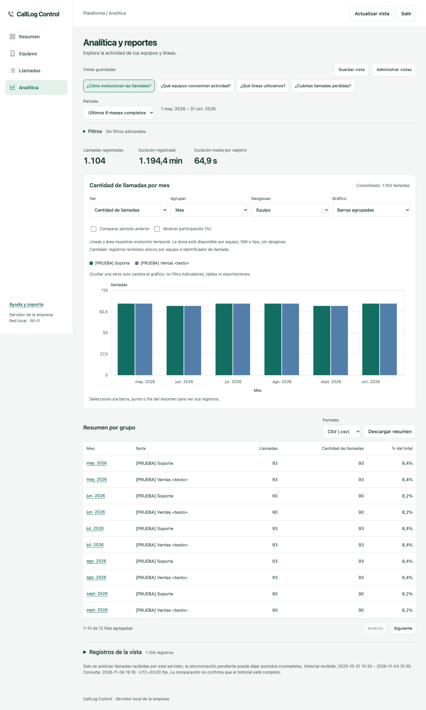

# CallLog Control

App Android en Kotlin y microservicio para registrar el historial de llamadas de equipos empresariales y exportarlo a CSV. El servidor usa **Python y SQLite, sin paquetes externos**. La distribución prevista es interna mediante APK o MDM.

**Instalar en Windows, macOS o Linux por Wi-Fi:** ver [WIFI.md](WIFI.md). Incluye una guía de PowerShell para **Windows sin Docker**, alternativas con Docker, HTTPS local, firewall, compilación del APK y CSV individual y conjunto. El servidor nativo solo necesita Python 3.11+ y Caddy 2; no requiere virtualización.

**Windows con asistente:** descargar el instalador o el ZIP de actualización del servidor [1.4.0](https://github.com/WestMorris/CallLogControl/releases/tag/v1.4.0) y seguir [WINDOWS.md](WINDOWS.md). Esta entrega añade Analítica y se actualiza solo en el servidor: los teléfonos conservan el APK 1.2.0, su historial y su vinculación, sin reinstalar ni generar nuevos QR. Para teléfonos nuevos se mantiene el [APK genérico 1.2.0](https://github.com/WestMorris/CallLogControl/releases/download/v1.2.0/CallLogControl-Android-1.2.0.apk). El instalador incluye Python y Caddy, configura servicios y firewall y conserva los datos al actualizar.

## Qué incluye

- Contraseña local creada en el primer inicio, con PBKDF2-HMAC-SHA256, sal aleatoria y espera de 30 segundos tras cinco errores. Se bloquea al abandonar la app. No hay contraseña predeterminada ni recuperación.
- Historial local con Room: número, tipo, fecha, duración, presentación del número y cuenta SIM/línea utilizada. No graba audio ni lee contactos, SMS o ubicación.
- Autorización explícita antes de importar las llamadas existentes y futuras. La captura continúa con la pantalla de la app bloqueada mientras conserva el permiso.
- `CallReceiver.kt` programa una importación al terminar la llamada. WorkManager vuelve a consultar el historial aproximadamente cada 15 minutos y al abrir la app desbloqueada.
- `CallService.kt` hace una importación manual breve con notificación visible. No mantiene un servicio permanente.
- Panel administrativo local organizado en **Resumen**, **Equipos**, detalle de cada equipo y **Llamadas**. Incluye cuentas SIM/línea, filtros por equipo, SIM y fechas, paginación con selector de 25, 50, 100 o 200 registros, CSV y solicitudes remotas. Ver [WIFI.md](WIFI.md).
- **Analítica:** reportes sobre las llamadas recibidas, con filtros, agrupaciones, gráficos, comparación de periodos y exportación CSV/Excel. Las vistas guardadas se comparten en el servidor y se conservan al actualizar.
- Alta desde el panel con nombre y QR de un solo uso, válido cinco minutos. La app 1.1.0 escanea con cámara y configura la URL, la credencial del teléfono y una autoridad TLS limitada a ese servidor, sin instalar certificados en Android.
- `RemoteSyncService.kt` ofrece un modo opcional de control remoto inmediato por Wi-Fi, con servicio visible, notificación permanente y mayor consumo de batería. Debe activarse en la app y permitir batería sin restricciones.
- Pantalla de las últimas 200 llamadas, totales globales y pendientes. CSV local con **todos** los registros, guardado mediante el selector de archivos de Android.
- `SyncWorker.kt` envía lotes de 100 registros por HTTPS, con reintentos y credencial propia por equipo. Nunca borra registros locales tras enviarlos.
- Servidor con almacenamiento idempotente, listado de equipos, revocación de credenciales y CSV de un equipo o de todos. Exportación por streaming para evitar cargar el historial completo en RAM.

## Capturas de pantalla

Las capturas usan únicamente datos ficticios: números de ejemplo, llamadas simuladas y equipos de prueba. No muestran registros reales ni credenciales.

### Aplicación Android

Creación de contraseña e historial local de llamadas.

<p>
  
  
</p>

### Panel web

Analítica del panel 1.4.0, con filtros, gráficos, vistas guardadas y exportación CSV/Excel. La captura utiliza llamadas ficticias.



## Compilar e instalar Android

Abrir esta carpeta en Android Studio. Requiere JDK 17 o superior compatible con Gradle 8.13, Android SDK 36 y Build Tools 35.0.0. Android mínimo: **8.0 / API 26**. Gradle descarga las dependencias en la primera compilación.

Usar un JDK actualizado. La verificación final se hizo con JDK 23.0.1; el JBR 17.0.9 de Android Studio instalado en este equipo sufrió un fallo interno de la JVM durante Lint. Para abrir el proyecto en otro equipo, configurar su propia ruta del SDK en `local.properties` o dejar que Android Studio la genere; ese archivo no se versiona.

```sh
./gradlew :app:assembleDebug :app:testDebugUnitTest :app:lintDebug
adb install -r app/build/outputs/apk/debug/app-debug.apk
```

En PowerShell de Windows, usar `.\gradlew.bat` en lugar de `./gradlew`. Si se instala el APK manualmente, no se necesita ADB. **El alta QR de 1.1.0 permite usar un APK genérico**, sin incorporar certificados al código. El procedimiento manual de certificados debug sigue disponible en [WIFI.md](WIFI.md#compilar-e-instalar-el-apk). Para actualizar una app instalada hay que conservar su clave de firma, también al cambiar de PC.

APK de desarrollo: `app/build/outputs/apk/debug/app-debug.apk`. Para distribución definitiva, generar un APK `release` firmado desde Android Studio y conservar la misma clave para futuras actualizaciones. No se incluye una clave de firma de producción.

En el teléfono:

1. Crear una contraseña de al menos ocho caracteres.
2. Pulsar **Autorizar acceso al historial**, leer el aviso y aceptar los permisos.
3. Pulsar **Actualizar** para importar el historial disponible.
4. Configurar **Servidor** con el origen HTTPS, por ejemplo `https://llamadas.empresa.com`, y la credencial del equipo emitida por el microservicio.
5. Pulsar **Sincronizar**. Al guardar la configuración se autoriza el envío de todo el historial local. Cambiar el destino o volver a guardar marca todo para reenvío; el servidor evita duplicados.

Para exportar localmente, pulsar **Exportar CSV** y elegir destino. Si el selector de archivos lleva la app a segundo plano, se pedirá desbloquear de nuevo antes de escribir el archivo. Los CSV contienen información sensible y quedan fuera de la protección por contraseña de la app.

Para detener la captura, revocar **Registro de llamadas** en los ajustes de Android. Para detener futuros envíos, usar **Servidor → Desactivar**; una solicitud ya enviada puede terminar antes de desactivarse. Los registros existentes se conservan.

## Servidor local para desarrollo

Python **3.11 o superior**, sin dependencias Python externas. Para instalar el servidor completo por Wi-Fi en Windows **sin Docker**, empezar por [esta guía de PowerShell](WIFI.md#a-windows-sin-docker), que añade Caddy para HTTPS y usa el puerto local 8088. Los siguientes comandos son para Bash/Zsh y arrancan solo la API de desarrollo en 8080, desde la raíz del proyecto:

```sh
export CALLLOG_ADMIN_TOKEN="$(python3 -c 'import secrets; print(secrets.token_urlsafe(48))')"
python3 server/server.py --data-dir server/data serve
```

Escucha en `127.0.0.1:8080`. Este HTTP local sirve para pruebas o para un proxy TLS en la misma máquina; la app Android **solo acepta HTTPS con un certificado de confianza**, sin redirecciones. Para pruebas Wi-Fi, la variante de depuración puede incluir la autoridad local propia siguiendo WIFI.md; ese certificado no se publica en el repositorio. No expongas directamente el puerto HTTP en Internet.

En otra terminal, registrar cada teléfono por separado:

```sh
python3 server/server.py --data-dir server/data register-device --name "Ventas 01"
```

Devuelve `device_id`, `name` y `token`. Guardar el identificador y entregar **solo la credencial de ese equipo** a su app. El token no puede recuperarse del servidor: se almacena su SHA-256. No reutilizar la credencial entre teléfonos. El administrador usa una credencial distinta que nunca debe introducirse en la app.

Revocar un teléfono perdido o retirado:

```sh
python3 server/server.py --data-dir server/data revoke-device ID_DEL_EQUIPO
```

La revocación impide nuevos ingresos y conserva el historial para las exportaciones. Para renovar una credencial, revocar el registro y dar de alta otro; aparecerá con un identificador nuevo.

## Despliegue con HTTPS

Se incluye Docker Compose con Python y Caddy, que obtiene y renueva el certificado TLS. Esta alternativa con dominio público requiere una máquina con Docker, un dominio apuntando a ella y los puertos 80 y 443 accesibles. Para Wi-Fi sin dominio, con o sin Docker, usar [WIFI.md](WIFI.md).

```sh
cp .env.example .env
# Editar .env: dominio real, correo y un secreto de administrador aleatorio.
# Generar el secreto con: python3 -c 'import secrets; print(secrets.token_urlsafe(48))'
docker compose up -d --build
docker compose exec api python server.py register-device --name "Ventas 01"
```

La app se configura con `https://TU_DOMINIO` y el `token` que devuelve el último comando. No necesita el identificador del equipo: el servidor lo deduce de la credencial.

El puerto 8080 no se publica. El límite de RAM es 128 MiB para la API y 128 MiB para Caddy; son límites configurados, **no un consumo medido ni una garantía de capacidad**. La API limita a 16 conexiones simultáneas, 500 registros por solicitud y cuerpos de 256 KiB. Para una flota pequeña se puede empezar con una instancia y un volumen persistente. Medir la carga antes de ampliar la flota.

```sh
docker compose exec api python server.py revoke-device ID_DEL_EQUIPO
docker compose logs --tail 100
```

Los datos están en el volumen `calllog_data`. No ejecutar `docker compose down -v` si se quieren conservar. Para copias consistentes en caliente, usar la API de backup de SQLite; copiar únicamente `calls.sqlite3` mientras está en uso puede omitir datos del WAL. Proteger y cifrar el disco y las copias del servidor.

## Exportaciones del servidor

Con `CALLLOG_ADMIN_TOKEN` definido en la terminal y `CALLLOG_URL` con la URL del servidor:

```sh
export CALLLOG_URL="https://llamadas.empresa.com"

# Equipos, IDs y cantidad de registros
curl --fail-with-body -H "Authorization: Bearer $CALLLOG_ADMIN_TOKEN" \
  "$CALLLOG_URL/v1/devices"

# Todos los equipos
curl --fail-with-body -H "Authorization: Bearer $CALLLOG_ADMIN_TOKEN" \
  "$CALLLOG_URL/v1/export.csv" -o llamadas-todos.csv

# Un equipo
curl --fail-with-body -H "Authorization: Bearer $CALLLOG_ADMIN_TOKEN" \
  "$CALLLOG_URL/v1/export.csv?device_id=ID_DEL_EQUIPO" -o llamadas-equipo.csv
```

El CSV del servidor conserva `equipo_id`, `equipo`, `llamada_id`, `numero`, `tipo`, `inicio_unix_ms` (UTC Unix en milisegundos), `duracion_segundos` y `presentacion`. Añade `inicio`, una fecha legible como **2026-11-04 09:30:00** (año-mes-día, hora de 24 horas), y `zona_horaria_inicio`, por ejemplo **UTC-03:00**. Para trabajar con fechas en Excel, usar `inicio`; `inicio_unix_ms` se conserva para compatibilidad. La conversión usa la zona horaria del servidor: comprobar que Windows tenga configurada la zona correcta antes de exportar. Usa UTF-8 con BOM y escape de comillas. Los valores que podrían convertirse en fórmulas de Excel reciben un apóstrofo inicial, incluidos los números telefónicos con `+`.

## Contrato HTTP

| Método y ruta | Credencial | Resultado |
| --- | --- | --- |
| `GET /healthz` | Ninguna | `200 {"status":"ok"}` |
| `POST /v1/calls` | Equipo activo | `204` solo después de persistir todo el lote |
| `GET /v1/devices` | Administrador | Equipos, conteos y lista `lines` de cuentas conocidas |
| `GET /v1/devices/{id}` | Administrador | Detalle `{device, lines}` del equipo y sus cuentas; `404` si no existe |
| `POST /v1/enrollments` | Administrador | `{"name":"Ventas 01"}` genera un QR con URL, autoridad y código temporal |
| `POST /v1/enrollments/claim` | Código del QR | Cuerpo `{}`; canje atómico por un teléfono con credencial propia, una sola vez |
| `GET /v1/calls?device_id=...&offset=0&limit=50` | Administrador | Página de llamadas; `limit` de 1 a 200, predeterminado 50; filtro opcional |
| `POST /v1/devices/{id}/sync` | Administrador | Encola una solicitud y devuelve `202` con `request_id` |
| `GET /v1/sync-request?wait=25` | Equipo activo | Espera hasta 25 segundos una solicitud pendiente |
| `POST /v1/sync-ack` | Equipo activo | Confirma `{"request_id":"UUID"}` después de importar y enviar todos los pendientes |
| `GET /v1/export.csv` | Administrador | CSV de todos los equipos |
| `GET /v1/export.csv?device_id=...` | Administrador | CSV del equipo, o `404` |
| `GET /v1/analytics?state=...` | Administrador | Indicadores, grupos y detalle paginado del estado JSON codificado en la URL |
| `GET /v1/analytics/export?state=...&kind=summary&format=xlsx` | Administrador | Descarga del resumen o detalle (`kind=summary` / `records`) en CSV o XLSX |
| `GET /v1/analytics/views` | Administrador | Biblioteca compartida de vistas y su revisión |
| `PUT /v1/analytics/views` | Administrador | Guarda `{revision, library}`; `409` si otra sesión ya cambió la revisión |

`GET /v1/calls` y `GET /v1/export.csv` aceptan también `started_from` (inicio inclusivo) y `started_before` (fin exclusivo), ambos Unix en milisegundos y combinables con `device_id`. Para una cuenta exacta, enviar juntos `phone_account_id` y `phone_account_component_name`: cadenas de hasta 256 caracteres, que pueden estar vacías. En el panel, seleccionar una SIM fija también su equipo para no mezclar cuentas de distintos teléfonos. El conteo, la paginación y el CSV aplican los mismos filtros; el CSV exporta todas las páginas. **Desde / Hasta → Aplicar fechas** incluye ambos días según la zona horaria del navegador. **CSV de la vista** respeta equipo, SIM y fechas aplicadas; **CSV conjunto** y el CSV de un equipo exportan su historial completo, sin esos filtros adicionales.

Las cuentas de `lines` se identifican por equipo, componente e identificador; su etiqueta es la más reciente recibida. No se crean opciones de SIM a partir de llamadas sin identidad de cuenta: esas filas siguen mostrando **No disponible**. El detalle de cada equipo reúne sus datos, cantidad de llamadas y cuentas conocidas; **Ver historial** abre **Llamadas** para ese equipo y limpia los filtros anteriores de SIM y fechas.

**Resumen** muestra totales globales del historial y las últimas cinco llamadas. La atención por contacto se calcula en equipos activos con más de 30 minutos desde el último contacto, o sin contacto registrado; indica antigüedad del contacto y no confirma que un teléfono esté desconectado. Los equipos revocados se muestran aparte.

### Analítica y reportes

En **Analítica**, aplicar equipo, cuenta SIM/línea, tipo y fechas; después elegir métrica, agrupación y desglose. Las cuentas se identifican por equipo, componente e identificador. **Sin SIM identificada** agrupa registros sin identidad de cuenta. Los indicadores y gráficos usan únicamente las llamadas recibidas por este servidor; una ausencia de registros no demuestra que no se hicieron llamadas.

Las fechas, los límites diarios y las semanas de Analítica usan **UTC−03:00 fijo**, con semanas desde el lunes. Esta zona se mantiene también en sus exportaciones, aunque el navegador o Windows utilicen otra. La comparación consulta el periodo anterior correspondiente entre los registros disponibles, sin garantizar que todos los teléfonos hayan enviado su historial completo. La duración media y la proporción de perdidas se recalculan a partir de registros, no promediando las medias o porcentajes de otros grupos.

Cada reporte admite hasta 20.000 combinaciones de grupo y serie. Si se supera ese límite, reducir el periodo, filtrar un equipo o quitar el desglose; el servidor rechaza el reporte sin modificar los registros. Excel admite hasta 1.048.575 filas de datos más la cabecera; para un detalle mayor, usar CSV o reducir filtros.

**Guardar vista** conserva los filtros aplicados y la configuración del gráfico; la selección temporal de un punto no forma parte de esa vista. **Administrar vistas** permite eliminar, deshacer y restaurar las predeterminadas. Se admiten hasta 16 vistas personalizadas con nombres de 50 caracteres. La biblioteca se guarda en SQLite y es compartida por las sesiones de administración de ese servidor. Eliminar una vista conserva llamadas y teléfonos. Si otra sesión guardó cambios, se rechaza la revisión anterior para evitar sobrescribirlos.

**Descargar resumen** incluye todos los grupos y **Descargar detalle** todos los registros de los filtros y la selección actual del gráfico, no solo la página visible. Elegir **CSV** o **Excel (.xlsx)** junto a cada botón. Ocultar una serie en la leyenda cambia únicamente el gráfico. Los archivos respetan la selección del detalle y mantienen números telefónicos y otros textos como texto; los valores que podrían ejecutarse como fórmulas se neutralizan.

Credenciales en `Authorization: Bearer TOKEN`. Ingreso con `Content-Type: application/json`:

```json
{
  "calls": [
    {
      "id": "123-1793361600000",
      "number": "+595991123456",
      "type": 2,
      "started_at": 1793361600000,
      "duration_seconds": 87,
      "presentation": 1,
      "phone_account_id": "cuenta-sim-2",
      "phone_account_component_name": "com.android.phone/com.android.services.telephony.TelephonyConnectionService",
      "line_label": "SIM 2"
    }
  ]
}
```

`id` combina el ID del proveedor Android y la fecha para evitar colisiones si el proveedor reutiliza IDs. La clave del servidor es `(equipo_id, llamada_id)`. Repetir una llamada actualiza sus datos; no crea otra fila. No se admite enviar un `equipo_id` en el cuerpo ni atribuir llamadas a otro equipo.

**SIM o línea por llamada (1.2.0):** la app lee `PHONE_ACCOUNT_ID` y `PHONE_ACCOUNT_COMPONENT_NAME` del historial de cada llamada, sin asignar la SIM predeterminada del teléfono. Guarda esa identidad y, cuando Android lo permite, el nombre de la cuenta. App, panel y ambos CSV muestran **SIM / línea** como nombre e identificador, o **No disponible** si faltan. El identificador puede ser interno; no equivale necesariamente al número telefónico ni al slot SIM 1/2. El permiso opcional `READ_PHONE_NUMBERS` permite obtener el nombre mediante `TelecomManager.getPhoneAccount`; rechazarlo no impide importar la identidad disponible en el historial. Referencias: [cuenta de la llamada](https://developer.android.com/reference/android/provider/CallLog.Calls#PHONE_ACCOUNT_ID), [nombre de la cuenta y permiso](https://developer.android.com/reference/android/telecom/TelecomManager#getPhoneAccount(android.telecom.PhoneAccountHandle)).

Los campos `phone_account_id`, `phone_account_component_name` y `line_label` son opcionales, cadenas de hasta 256 caracteres. Los clientes anteriores siguen enviando sus seis campos y no borran información de línea ya recibida. Las migraciones añaden columnas sin eliminar historial, estado de sincronización, equipos ni credenciales. Los CSV conservan el orden anterior y añaden `sim_o_linea`, `cuenta_telefonica_id` y `cuenta_telefonica_componente` al final.

La actualización del panel 1.4.0 conserva el APK Android 1.2.0; basta actualizar el servidor y recargar el panel. Conserva llamadas, equipos, credenciales, certificados e IP, y añade almacenamiento para las vistas compartidas de Analítica.

Para incorporar los datos de SIM en una app anterior a 1.2.0: actualizar primero el servidor y después instalar el APK 1.2.0 encima del anterior con la misma firma; abrir la app, conceder el permiso de nombres si se desea y pulsar **Actualizar → Sincronizar**. Se vuelve a consultar el historial y se reenvían las llamadas cuyos datos de línea se completaron. Las llamadas que ya no estén en el historial Android conservan sus datos previos; no se inventa su SIM. No desinstalar la app ni generar nuevos QR.

Tipos: 1 entrante, 2 saliente, 3 perdida, 4 buzón de voz, 5 rechazada, 6 bloqueada, 7 contestada en otro equipo. `presentation` conserva el valor de Android (1–5). No se admiten campos extras. Un lote inválido se rechaza completo. La app marca registros enviados únicamente con `204` y solo si no han cambiado mientras estaban en tránsito. Errores o reintentos conservan los pendientes.

## Pruebas

```sh
python3 -m unittest discover -s server -v
node server/test_panel.js
./gradlew :app:testDebugUnitTest :app:lintDebug :app:assembleDebug

# Con emulador o teléfono conectado
./gradlew :app:connectedDebugAndroidTest
```

Equivalentes en PowerShell: `py -3 -m unittest discover -s server -v` y `.\gradlew.bat` para las tareas Gradle.

Las pruebas del servidor cubren credenciales, aislamiento, revocación, reintentos sin duplicados, actualizaciones, validación atómica, límites y ambos CSV. Las pruebas Kotlin cubren contraseña, URL HTTPS y escape CSV. La prueba instrumentada verifica Room, conservación de confirmaciones y rechazo de confirmaciones obsoletas.

Ejecutar las pruebas instrumentadas en un **emulador dedicado sin datos reales**: la prueba de interfaz reinicia las preferencias de seguridad de la app de desarrollo y genera capturas con datos de prueba en `Pictures/CallLogControl`.

Validar en cada modelo de teléfono: una llamada entrante, saliente, perdida y rechazada; llamadas seguidas; reinicio; modo avión y recuperación; permiso revocado; credencial revocada; app bloqueada; exportación. Las pruebas de emulador no sustituyen las llamadas reales.

Verificación realizada el **30/10/2026**: APK debug compilado, pruebas Kotlin y Lint sin errores. Las pruebas HTTP cubren también el panel, la paginación, migración de la base, aislamiento de comandos, confirmaciones y respuesta del canal remoto. El servidor Docker preservó los 19 registros existentes tras actualizar. Se verificaron filtro, solicitud y ambos CSV desde el navegador con datos ficticios. Una solicitud real por HTTPS se completó en **0,756 segundos**, con la actividad Android cerrada y Doze forzado en un emulador Android 14 con excepción de batería. La velocidad y continuidad del modo remoto deben validarse en el teléfono físico.

La entrega **1.1.0** añade quince pruebas de servidor/configuración, instalación y ciclo de vida real de los servicios en Windows Server 2022 y cinco pruebas instrumentadas Android, incluyendo QR y TLS por servidor. Detalles y límites de verificación en [WINDOWS.md](WINDOWS.md#verificación-de-esta-entrega).

Verificación **1.2.0, 04/11/2026**: 22 pruebas de servidor/configuración, pruebas JavaScript del panel, cuatro pruebas Kotlin y Lint sin errores. En Android 14 se verificaron seis pruebas de importación, migración Room e interfaz y dos de QR/TLS, incluido el envío real de dos cuentas distintas del mismo teléfono por HTTPS. Se comprobó el panel en escritorio y móvil con datos ficticios y el CSV filtrado. El APK genérico conserva el certificado de firma del APK público 1.1.0 y no incluye una CA local. Falta validar llamadas con dos SIM en teléfonos físicos; dos escenarios anteriores de Wi-Fi/control remoto no se repitieron en esta entrega.

Verificación local **1.4.0, 04/11/2026**: 32 pruebas Python, pruebas JavaScript del panel y revisión de Analítica en Chrome de escritorio y móvil (320 y 390 píxeles). Se comprobaron gráficos, medias, comparación, SIM exacta, selección y paginación, descargas CSV/XLSX completas y vistas guardadas después de recargar. Una exportación demorada 6,5 segundos sobrevivió al refresco automático; cerrar sesión descartó una descarga pendiente. Los flujos del navegador conservaron los 2.220 registros ficticios y todos los equipos y hashes de credenciales del servidor de prueba. La publicación de paquetes requiere además el workflow Windows, que prueba la actualización real desde 1.3.0, rollback, reinstalación y conservación de datos y certificados. Android permanece en 1.2.0 y no se recompiló para esta entrega.

Verificación local **1.3.0, 04/11/2026**: 24 pruebas Python, pruebas JavaScript de navegación, filtros, QR y aislamiento entre sesiones, y revisión real en Chrome de escritorio y móvil (320 y 390 píxeles). Se comprobaron detalle de equipo, historial, paginación, CSV filtrado, QR y solicitudes pendientes con datos ficticios. Las consultas de detalle y filtros no modifican el esquema, los registros ni las credenciales. Android permanece en 1.2.0 y no se recompiló para esta entrega.

## Restricciones y protección de datos

- `READ_CALL_LOG` es un permiso **restringido**: además del consentimiento, el instalador o MDM debe permitirlo cuando Android lo requiera. Distribuir internamente no elimina esa restricción. No se implementa un marcador telefónico predeterminado.
- Google Play limita el permiso de historial de llamadas. Esta primera versión está preparada para distribución interna; publicar en Play requiere revisar la elegibilidad del caso de uso.
- WorkManager es diferido. Ahorro de batería, políticas del fabricante y detención forzada pueden retrasar las importaciones. Al recuperar acceso, se reconcilia lo que siga disponible en el historial del teléfono. No hay promesa de captura inmediata, ejecución continua ni recuperación de entradas borradas antes de ser importadas.
- Los servicios de tipo `dataSync` tienen límites en Android moderno. Por eso el servicio manual finaliza tras importar y la captura habitual usa WorkManager.
- El control remoto inmediato usa un servicio opcional `specialUse`, visible y autorizado por el usuario, para mantener el canal local. Necesita Wi-Fi accesible y excepción de batería. Aumenta el consumo y no evita Forzar detención ni las restricciones particulares del fabricante. Tras reiniciar el teléfono debe volver a activarse.
- La contraseña protege la interfaz. Room y SQLite no tienen cifrado propio: dependen del sandbox/cifrado del dispositivo y de los permisos/cifrado del disco del servidor. La credencial Android sí se guarda con AES-GCM y Android Keystore. No se permiten copias de seguridad automáticas de la app ni tráfico HTTP desde ella.
- HTTPS cifra el transporte; el servidor necesita leer los registros para generar CSV. No hay cifrado de extremo a extremo. No se registran números ni credenciales en los logs HTTP de la API.
- No hay borrado automático ni política de retención. Desinstalar o borrar los datos de la app elimina el historial local y la contraseña; no borra los registros ya recibidos en el servidor. Debe definirse una política empresarial de conservación y acceso antes de desplegar.
- El panel usa la credencial de administrador, sin cuentas adicionales, y mantiene la sesión solo en memoria del navegador. No hay recuperación de contraseña, grabación de audio ni publicación automática.

Referencias: [permisos Android](https://developer.android.com/reference/android/Manifest.permission#READ_CALL_LOG), [tipos de servicios en primer plano](https://developer.android.com/develop/background-work/services/fgs/service-types), [política de permisos de llamadas de Google Play](https://support.google.com/googleplay/android-developer/answer/10208820).

## Licencia

Este proyecto se distribuye bajo la [licencia MIT](LICENSE). Permite usar, modificar y distribuir el código, incluso comercialmente, conservando el aviso de copyright y la licencia. Las dependencias y archivos de terceros conservan sus propias licencias; ver [THIRD_PARTY_NOTICES.md](THIRD_PARTY_NOTICES.md).
