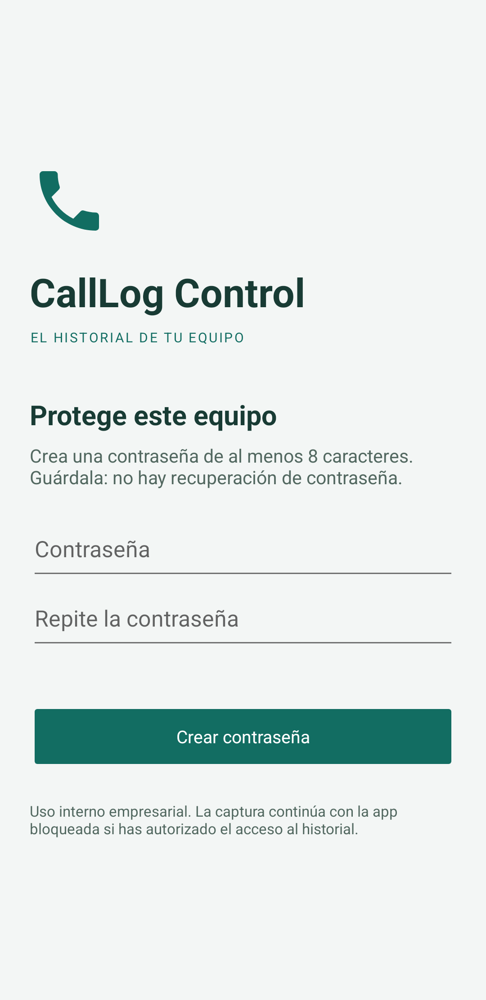
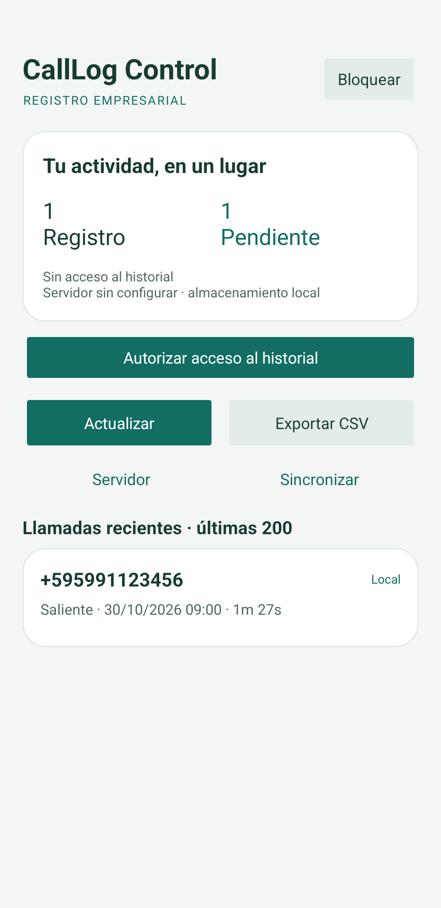
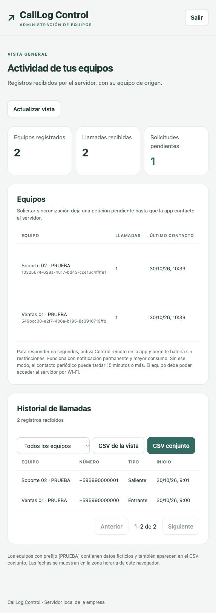

# CallLog Control

App Android en Kotlin y microservicio para registrar el historial de llamadas de equipos empresariales y exportarlo a CSV. El servidor usa **Python y SQLite, sin paquetes externos**. La distribución prevista es interna mediante APK o MDM.

**Pruebas en la misma Wi-Fi:** ver [WIFI.md](WIFI.md). Incluye el servidor local sin dominio público, el APK con confianza TLS de depuración y los comandos para CSV individual y conjunto.

## Qué incluye

- Contraseña local creada en el primer inicio, con PBKDF2-HMAC-SHA256, sal aleatoria y espera de 30 segundos tras cinco errores. Se bloquea al abandonar la app. No hay contraseña predeterminada ni recuperación.
- Historial local con Room: número, tipo, fecha, duración y presentación del número. No graba audio ni lee contactos, SMS o ubicación.
- Autorización explícita antes de importar las llamadas existentes y futuras. La captura continúa con la pantalla de la app bloqueada mientras conserva el permiso.
- `CallReceiver.kt` programa una importación al terminar la llamada. WorkManager vuelve a consultar el historial aproximadamente cada 15 minutos y al abrir la app desbloqueada.
- `CallService.kt` hace una importación manual breve con notificación visible. No mantiene un servicio permanente.
- Panel administrativo local: equipos, llamadas paginadas, filtro por equipo, CSV y solicitudes remotas. Ver [WIFI.md](WIFI.md).
- `RemoteSyncService.kt` ofrece un modo opcional de control remoto inmediato por Wi-Fi, con servicio visible, notificación permanente y mayor consumo de batería. Debe activarse en la app y permitir batería sin restricciones.
- Pantalla de las últimas 200 llamadas, totales globales y pendientes. CSV local con **todos** los registros, guardado mediante el selector de archivos de Android.
- `SyncWorker.kt` envía lotes de 100 registros por HTTPS, con reintentos y credencial propia por equipo. Nunca borra registros locales tras enviarlos.
- Servidor con almacenamiento idempotente, listado de equipos, revocación de credenciales y CSV de un equipo o de todos. Exportación por streaming para evitar cargar el historial completo en RAM.

## Capturas de pantalla

Las capturas usan únicamente datos ficticios: números de ejemplo, llamadas simuladas y equipos de prueba. No muestran registros reales ni credenciales.

### Aplicación Android

Creación de contraseña e historial local de llamadas.

<p>
  
  
</p>

### Panel web

Vista de equipos, solicitudes de sincronización y llamadas simuladas de Ventas y Soporte.



## Compilar e instalar Android

Abrir esta carpeta en Android Studio. Requiere JDK 17 o superior compatible con Gradle 8.13, Android SDK 36 y Build Tools 35.0.0. Android mínimo: **8.0 / API 26**. Gradle descarga las dependencias en la primera compilación.

Usar un JDK actualizado. La verificación final se hizo con JDK 23.0.1; el JBR 17.0.9 de Android Studio instalado en este equipo sufrió un fallo interno de la JVM durante Lint. Para abrir el proyecto en otro equipo, configurar su propia ruta del SDK en `local.properties` o dejar que Android Studio la genere; ese archivo no se versiona.

```sh
./gradlew :app:assembleDebug :app:testDebugUnitTest :app:lintDebug
adb install -r app/build/outputs/apk/debug/app-debug.apk
```

APK de desarrollo: `app/build/outputs/apk/debug/app-debug.apk`. Para distribución definitiva, generar un APK `release` firmado desde Android Studio y conservar la misma clave para futuras actualizaciones. No se incluye una clave de firma de producción.

En el teléfono:

1. Crear una contraseña de al menos ocho caracteres.
2. Pulsar **Autorizar acceso al historial**, leer el aviso y aceptar los permisos.
3. Pulsar **Actualizar** para importar el historial disponible.
4. Configurar **Servidor** con el origen HTTPS, por ejemplo `https://llamadas.empresa.com`, y la credencial del equipo emitida por el microservicio.
5. Pulsar **Sincronizar**. Al guardar la configuración se autoriza el envío de todo el historial local. Cambiar el destino o volver a guardar marca todo para reenvío; el servidor evita duplicados.

Para exportar localmente, pulsar **Exportar CSV** y elegir destino. Si el selector de archivos lleva la app a segundo plano, se pedirá desbloquear de nuevo antes de escribir el archivo. Los CSV contienen información sensible y quedan fuera de la protección por contraseña de la app.

Para detener la captura, revocar **Registro de llamadas** en los ajustes de Android. Para detener futuros envíos, usar **Servidor → Desactivar**; una solicitud ya enviada puede terminar antes de desactivarse. Los registros existentes se conservan.

## Servidor local para desarrollo

Python **3.11 o superior**. Ejecutar desde la raíz del proyecto:

```sh
export CALLLOG_ADMIN_TOKEN="$(python3 -c 'import secrets; print(secrets.token_urlsafe(48))')"
python3 server/server.py --data-dir server/data serve
```

Escucha en `127.0.0.1:8080`. Este HTTP local sirve para pruebas o para un proxy TLS en la misma máquina; la app Android **solo acepta HTTPS con un certificado de confianza**, sin redirecciones. Para pruebas Wi-Fi, la variante de depuración puede incluir la autoridad local propia siguiendo WIFI.md; ese certificado no se publica en el repositorio. No expongas directamente el puerto HTTP en Internet.

En otra terminal, registrar cada teléfono por separado:

```sh
python3 server/server.py --data-dir server/data register-device --name "Ventas 01"
```

Devuelve `device_id`, `name` y `token`. Guardar el identificador y entregar **solo la credencial de ese equipo** a su app. El token no puede recuperarse del servidor: se almacena su SHA-256. No reutilizar la credencial entre teléfonos. El administrador usa una credencial distinta que nunca debe introducirse en la app.

Revocar un teléfono perdido o retirado:

```sh
python3 server/server.py --data-dir server/data revoke-device ID_DEL_EQUIPO
```

La revocación impide nuevos ingresos y conserva el historial para las exportaciones. Para renovar una credencial, revocar el registro y dar de alta otro; aparecerá con un identificador nuevo.

## Despliegue con HTTPS

Se incluye Docker Compose con Python y Caddy, que obtiene y renueva el certificado TLS. Hace falta una máquina con Docker, un dominio apuntando a ella y los puertos 80 y 443 accesibles.

```sh
cp .env.example .env
# Editar .env: dominio real, correo y un secreto de administrador aleatorio.
# Generar el secreto con: python3 -c 'import secrets; print(secrets.token_urlsafe(48))'
docker compose up -d --build
docker compose exec api python server.py register-device --name "Ventas 01"
```

La app se configura con `https://TU_DOMINIO` y el `token` que devuelve el último comando. No necesita el identificador del equipo: el servidor lo deduce de la credencial.

El puerto 8080 no se publica. El límite de RAM es 128 MiB para la API y 128 MiB para Caddy; son límites configurados, **no un consumo medido ni una garantía de capacidad**. La API limita a 16 conexiones simultáneas, 500 registros por solicitud y cuerpos de 256 KiB. Para una flota pequeña se puede empezar con una instancia y un volumen persistente. Medir la carga antes de ampliar la flota.

```sh
docker compose exec api python server.py revoke-device ID_DEL_EQUIPO
docker compose logs --tail 100
```

Los datos están en el volumen `calllog_data`. No ejecutar `docker compose down -v` si se quieren conservar. Para copias consistentes en caliente, usar la API de backup de SQLite; copiar únicamente `calls.sqlite3` mientras está en uso puede omitir datos del WAL. Proteger y cifrar el disco y las copias del servidor.

## Exportaciones del servidor

Con `CALLLOG_ADMIN_TOKEN` definido en la terminal y `CALLLOG_URL` con la URL del servidor:

```sh
export CALLLOG_URL="https://llamadas.empresa.com"

# Equipos, IDs y cantidad de registros
curl --fail-with-body -H "Authorization: Bearer $CALLLOG_ADMIN_TOKEN" \
  "$CALLLOG_URL/v1/devices"

# Todos los equipos
curl --fail-with-body -H "Authorization: Bearer $CALLLOG_ADMIN_TOKEN" \
  "$CALLLOG_URL/v1/export.csv" -o llamadas-todos.csv

# Un equipo
curl --fail-with-body -H "Authorization: Bearer $CALLLOG_ADMIN_TOKEN" \
  "$CALLLOG_URL/v1/export.csv?device_id=ID_DEL_EQUIPO" -o llamadas-equipo.csv
```

El CSV del servidor contiene `equipo_id`, `equipo`, `llamada_id`, `numero`, `tipo`, `inicio_unix_ms` (UTC Unix en milisegundos), `duracion_segundos` y `presentacion`. Usa UTF-8 con BOM y escape de comillas. Los valores que podrían convertirse en fórmulas de Excel reciben un apóstrofo inicial, incluidos los números telefónicos con `+`.

## Contrato HTTP

| Método y ruta | Credencial | Resultado |
| --- | --- | --- |
| `GET /healthz` | Ninguna | `200 {"status":"ok"}` |
| `POST /v1/calls` | Equipo activo | `204` solo después de persistir todo el lote |
| `GET /v1/devices` | Administrador | Lista de equipos y conteos |
| `GET /v1/calls?device_id=...&offset=0` | Administrador | Página de 50 llamadas; filtro opcional |
| `POST /v1/devices/{id}/sync` | Administrador | Encola una solicitud y devuelve `202` con `request_id` |
| `GET /v1/sync-request?wait=25` | Equipo activo | Espera hasta 25 segundos una solicitud pendiente |
| `POST /v1/sync-ack` | Equipo activo | Confirma `{"request_id":"UUID"}` después de importar y enviar todos los pendientes |
| `GET /v1/export.csv` | Administrador | CSV de todos los equipos |
| `GET /v1/export.csv?device_id=...` | Administrador | CSV del equipo, o `404` |

Credenciales en `Authorization: Bearer TOKEN`. Ingreso con `Content-Type: application/json`:

```json
{
  "calls": [
    {
      "id": "123-1793361600000",
      "number": "+595991123456",
      "type": 2,
      "started_at": 1793361600000,
      "duration_seconds": 87,
      "presentation": 1
    }
  ]
}
```

`id` combina el ID del proveedor Android y la fecha para evitar colisiones si el proveedor reutiliza IDs. La clave del servidor es `(equipo_id, llamada_id)`. Repetir una llamada actualiza sus datos; no crea otra fila. No se admite enviar un `equipo_id` en el cuerpo ni atribuir llamadas a otro equipo.

Tipos: 1 entrante, 2 saliente, 3 perdida, 4 buzón de voz, 5 rechazada, 6 bloqueada, 7 contestada en otro equipo. `presentation` conserva el valor de Android (1–5). No se admiten campos extras. Un lote inválido se rechaza completo. La app marca registros enviados únicamente con `204` y solo si no han cambiado mientras estaban en tránsito. Errores o reintentos conservan los pendientes.

## Pruebas

```sh
python3 -m unittest discover -s server -v
./gradlew :app:testDebugUnitTest :app:lintDebug :app:assembleDebug

# Con emulador o teléfono conectado
./gradlew :app:connectedDebugAndroidTest
```

Las pruebas del servidor cubren credenciales, aislamiento, revocación, reintentos sin duplicados, actualizaciones, validación atómica, límites y ambos CSV. Las pruebas Kotlin cubren contraseña, URL HTTPS y escape CSV. La prueba instrumentada verifica Room, conservación de confirmaciones y rechazo de confirmaciones obsoletas.

Ejecutar las pruebas instrumentadas en un **emulador dedicado sin datos reales**: la prueba de interfaz reinicia las preferencias de seguridad de la app de desarrollo y genera capturas con datos de prueba en `Pictures/CallLogControl`.

Validar en cada modelo de teléfono: una llamada entrante, saliente, perdida y rechazada; llamadas seguidas; reinicio; modo avión y recuperación; permiso revocado; credencial revocada; app bloqueada; exportación. Las pruebas de emulador no sustituyen las llamadas reales.

Verificación realizada el **30/10/2026**: APK debug compilado, pruebas Kotlin y Lint sin errores. Las 11 pruebas HTTP cubren también el panel, la paginación, migración de la base, aislamiento de comandos, confirmaciones y respuesta del canal remoto. El servidor Docker preservó los 19 registros existentes tras actualizar. Se verificaron filtro, solicitud y ambos CSV desde el navegador con datos ficticios. Una solicitud real por HTTPS se completó en **0,756 segundos**, con la actividad Android cerrada y Doze forzado en un emulador Android 14 con excepción de batería. La velocidad y continuidad del modo remoto deben validarse en el teléfono físico.

## Restricciones y protección de datos

- `READ_CALL_LOG` es un permiso **restringido**: además del consentimiento, el instalador o MDM debe permitirlo cuando Android lo requiera. Distribuir internamente no elimina esa restricción. No se implementa un marcador telefónico predeterminado.
- Google Play limita el permiso de historial de llamadas. Esta primera versión está preparada para distribución interna; publicar en Play requiere revisar la elegibilidad del caso de uso.
- WorkManager es diferido. Ahorro de batería, políticas del fabricante y detención forzada pueden retrasar las importaciones. Al recuperar acceso, se reconcilia lo que siga disponible en el historial del teléfono. No hay promesa de captura inmediata, ejecución continua ni recuperación de entradas borradas antes de ser importadas.
- Los servicios de tipo `dataSync` tienen límites en Android moderno. Por eso el servicio manual finaliza tras importar y la captura habitual usa WorkManager.
- El control remoto inmediato usa un servicio opcional `specialUse`, visible y autorizado por el usuario, para mantener el canal local. Necesita Wi-Fi accesible y excepción de batería. Aumenta el consumo y no evita Forzar detención ni las restricciones particulares del fabricante. Tras reiniciar el teléfono debe volver a activarse.
- La contraseña protege la interfaz. Room y SQLite no tienen cifrado propio: dependen del sandbox/cifrado del dispositivo y de los permisos/cifrado del disco del servidor. La credencial Android sí se guarda con AES-GCM y Android Keystore. No se permiten copias de seguridad automáticas de la app ni tráfico HTTP desde ella.
- HTTPS cifra el transporte; el servidor necesita leer los registros para generar CSV. No hay cifrado de extremo a extremo. No se registran números ni credenciales en los logs HTTP de la API.
- No hay borrado automático ni política de retención. Desinstalar o borrar los datos de la app elimina el historial local y la contraseña; no borra los registros ya recibidos en el servidor. Debe definirse una política empresarial de conservación y acceso antes de desplegar.
- El panel usa la credencial de administrador, sin cuentas adicionales, y mantiene la sesión solo en memoria del navegador. No hay recuperación de contraseña, grabación de audio ni publicación automática.

Referencias: [permisos Android](https://developer.android.com/reference/android/Manifest.permission#READ_CALL_LOG), [tipos de servicios en primer plano](https://developer.android.com/develop/background-work/services/fgs/service-types), [política de permisos de llamadas de Google Play](https://support.google.com/googleplay/android-developer/answer/10208820).

## Licencia

Este proyecto se distribuye bajo la [licencia MIT](LICENSE). Permite usar, modificar y distribuir el código, incluso comercialmente, conservando el aviso de copyright y la licencia. Las dependencias y archivos de terceros conservan sus propias licencias.
