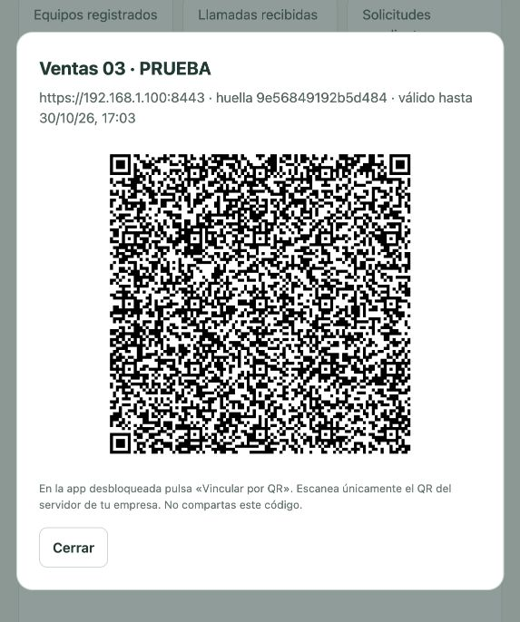

# Windows sin Docker: instalación con asistente

## Descargar e instalar

Descargar los archivos de [CallLog Control 1.2.0](https://github.com/WestMorris/CallLogControl/releases/tag/v1.2.0):

- **`CallLogControl-Setup-1.2.0-x64.exe`** para instalar el servidor con asistente.
- **`CallLogControl-ServerUpdate-1.2.0.zip`** para actualizar solo el servidor de una instalación existente, conservando los teléfonos vinculados.
- **`CallLogControl-Android-1.2.0.apk`** para los teléfonos nuevos y existentes.
- `SHA256SUMS.txt` permite comprobar la integridad de las descargas.

Actualizar primero el servidor y después instalar el APK 1.2.0 encima del anterior con la misma firma. Así se conserva historial, contraseña y vinculación; no generar nuevos QR. Los teléfonos con la versión anterior siguen sincronizando, aunque no envían información de SIM/línea.

Requiere **Windows 10/11 de 64 bits, Intel/AMD**, permisos de administrador y una red local que permita comunicación con los teléfonos. No requiere Docker, WSL, virtualización, Python instalado, Java ni Android Studio en el servidor. El instalador incluye los componentes; después de descargarlo se puede instalar sin Internet.

1. Ejecutar el `.exe` y aceptar la elevación de Windows.
2. Elegir la carpeta del programa. En **IP del servidor** dejar `auto`, o indicar la IPv4 del adaptador conectado a la red de los teléfonos si hay varias interfaces o una VPN. Desde el instalador 1.1.1, `auto` conserva la IP guardada cuando se actualiza una instalación existente.
3. Esperar a que termine: instala y arranca los servicios, prepara SQLite y los certificados y configura el firewall.
4. Abrir **Administrar CallLog Control** desde el escritorio o el menú Inicio. El botón **Copiar clave y abrir panel** copia la credencial y abre `http://127.0.0.1:8088/`. Pegar la clave para entrar. El acceso a esa clave pide permisos de administrador; no se pasa por la URL ni se guarda en el navegador.

El instalador **no tiene firma digital de editor**. Windows puede mostrar una advertencia de editor desconocido. Descargarlo únicamente desde el repositorio del proyecto y comprobar el hash si la política de la empresa lo requiere. El APK distribuido es una compilación de desarrollo para las pruebas internas; para distribución definitiva se debe usar una firma empresarial conservada por su administrador.

Si existe un servidor manual o Docker en ese PC, detenerlo antes: puede ocupar los puertos 8088/8443. El instalador crea su propia instalación; **no importa automáticamente** bases, credenciales o certificados de otra máquina o de volúmenes Docker.

## Agregar teléfonos por QR

1. Instalar el APK 1.2.0 en el teléfono. Se puede transferir el archivo desde el PC; el servidor ya no necesita compilar un APK con su certificado.
2. Conectar teléfono y servidor a la misma red. Abrir la app y crear o introducir la contraseña local.
3. En el panel del PC, escribir un nombre —por ejemplo, **Ventas 01**— y pulsar **Generar QR**.
4. En la app desbloqueada, pulsar **Vincular por QR** y permitir la cámara. Escanear el QR del panel. Al volver de la cámara, desbloquear la app y confirmar el servidor. La huella corta que aparece debe coincidir con la del panel.
5. Pulsar **Vincular y sincronizar**. Si aún falta, autorizar el historial y pulsar **Actualizar → Sincronizar**. Confirmar las llamadas en el panel.

Cada QR caduca a los **cinco minutos**, funciona **una sola vez** y asigna una credencial diferente al nuevo equipo. El equipo aparece al completar el alta, no al generar la invitación. No compartir ni publicar QR reales. Si falla el canje después de usarse, generar otro; una interrupción justo después de dar de alta puede dejar un registro sin llamadas con el mismo nombre.

El QR incorpora la URL HTTPS y el certificado público de la autoridad del servidor. La app verifica la cadena y el nombre/IP del certificado. Esa confianza se usa solo para su conexión configurada: no instala autoridades en Android ni desactiva TLS. No contiene la clave de administrador ni claves privadas. Instalar únicamente QR procedentes del panel de la empresa: autorizar otra instalación permite que reciba el historial local.

No hace falta escribir la URL, UUID o token del teléfono. Todos los teléfonos pueden usar el mismo APK genérico; cada uno escanea su propio QR. El nombre visible se elige en el panel al generar el alta. Las versiones anteriores a 1.1.0 requieren actualizarse para leerlo.

**Actualizar una app existente:** mantener la misma firma Android. El APK de esta entrega conserva la firma de desarrollo utilizada en las entregas anteriores de este proyecto; si se compiló una app propia en otro PC, puede tener otra clave. No desinstalar como primer recurso: se perderían su historial local y configuración. Conservar la clave propia y compilar el código nuevo si se necesita mantener esa firma. Al cambiar de servidor o equipo se vuelve a enviar el historial local; las llamadas recibidas en otro servidor no se trasladan solas.

Los teléfonos vinculados por QR conservan su certificado guardado. Si una compilación propia se configuró manualmente y confiaba únicamente en una CA incorporada al APK debug, recompilar la actualización con esa misma CA y firma siguiendo [WIFI.md](WIFI.md#compilar-e-instalar-el-apk); el APK genérico no incluye autoridades privadas de una instalación.

Captura con datos ficticios y una invitación de prueba sin acceso a instalaciones reales:



## Panel, CSV y sincronización remota

La tabla incluye **SIM / línea** y paginación con **Registros por página: 25, 50, 100 o 200**, rango visible y total. Cambiar filtros o cantidad vuelve a la primera página. Los CSV contienen todos los resultados del filtro, aunque la tabla muestre una sola página. Las nuevas columnas `sim_o_linea`, `cuenta_telefonica_id` y `cuenta_telefonica_componente` se añaden al final. Se muestra el nombre e identificador que Android aporta para cada llamada; si falta, **No disponible**.

En el panel se puede filtrar el historial y descargar **CSV de la vista** (un equipo si está seleccionado) o **CSV conjunto**. El nombre y el identificador de origen se incluyen en cada fila. El CSV contiene lo que ya recibió el servidor: pedir la sincronización y esperar su confirmación antes de descargar si se necesita lo más reciente.

La actualización del servidor 1.1.1 añade filtros **Desde** y **Hasta** por días completos, según la zona horaria del navegador. **CSV de la vista** respeta equipo y fechas; **CSV conjunto** incluye todos los equipos y todo el historial. Los botones **CSV** de cada equipo exportan su historial completo, sin filtro de fechas. La columna nueva **`inicio`** usa `AAAA-MM-DD HH:MM:SS` para abrirla en Excel, y **`zona_horaria_inicio`** indica el desplazamiento UTC de esa fecha en el servidor. Comprobar que la zona horaria de Windows sea correcta antes de exportar. Se conserva **`inicio_unix_ms`**, el valor original en milisegundos desde el 01/01/1970, para integraciones; no es una fecha de Excel. El archivo conserva UTF-8 con BOM y separación por comas; si Excel lo abre en una sola columna, importarlo desde **Datos → Desde texto/CSV**, eligiendo UTF-8 y coma.

Para responder en segundos con la app cerrada, activar **Control remoto** en Android y permitir notificaciones y batería sin restricciones. La notificación queda visible y hay mayor consumo de batería. El alta por QR no activa ese servicio sin consentimiento. Tras reiniciar el teléfono hay que reactivarlo; Forzar detención y las políticas del fabricante pueden impedir la respuesta.

Los dos servicios de Windows arrancan automáticamente al iniciar Windows, sin abrir sesión:

| Servicio | Función |
| --- | --- |
| `CallLogControlAPI` | Python, SQLite, panel local y API |
| `CallLogControlHTTPS` | Caddy, HTTPS en la IPv4 configurada, puerto 8443 |

Se ejecutan como **LocalService**, sin permisos de administrador, y se configura reinicio tras un fallo. Se pueden detener o iniciar desde **Servicios** (`services.msc`). El PC debe permanecer encendido y sin suspensión. El arranque automático del PC no garantiza conectividad si su Wi-Fi no se conecta antes del inicio de sesión.

La regla de firewall permite TCP 8443 al ejecutable Caddy desde la subred local en perfiles **Privado o Dominio**; no abre 8088 por la LAN ni cambia una red pública a privada. Marcar como privada únicamente una red de confianza. Una política empresarial puede bloquear la regla y requerir intervención de su administrador.

## Datos, actualizaciones y desinstalación

El programa se instala por defecto en `C:\Program Files\CallLogControl`. Los datos se conservan aparte en **`C:\ProgramData\CallLogControl`** (ProgramData puede estar oculta):

| Ruta dentro de ProgramData\CallLogControl | Contenido |
| --- | --- |
| `data\calls.sqlite3` y archivos WAL asociados | Equipos, llamadas e invitaciones |
| `config.json`, `admin-key.txt` | Configuración y credencial administrativa |
| `caddy\` | Autoridad, certificados y claves privadas |
| `logs\` | Logs con rotación de los servicios |
| `setup-error.txt` | Motivo de un fallo de instalación, si lo hubo |

La carpeta queda restringida a administradores, SYSTEM y LocalService mediante permisos NTFS. No compartir su contenido ni subirlo a Git. Los CSV descargados y la clave copiada al portapapeles quedan fuera de esa carpeta: manejarlos con los controles de la empresa.

Para actualizar, ejecutar el instalador nuevo en la misma carpeta. Se detienen los servicios, se actualizan los archivos y se vuelven a iniciar, conservando configuración, registros y autoridad. Antes de actualizar, hacer una copia: detener **ambos servicios**, copiar toda la carpeta de ProgramData a un destino protegido y volver a iniciarlos. No copiar solo el archivo SQLite mientras se escribe en él.

### Actualización 1.2.0 del servidor y los teléfonos

Para una instalación creada con el asistente 1.1.0 o 1.1.1, el paquete **`CallLogControl-ServerUpdate-1.2.0.zip`** actualiza el servidor conservando los teléfonos vinculados:

1. Extraer todo el ZIP en una carpeta del PC servidor distinta de la instalación y de ProgramData, por ejemplo una carpeta nueva en el escritorio.
2. Abrir **`windows\Update-Server.cmd`** y aceptar la elevación de Windows. El script detecta la carpeta de instalación desde los servicios existentes. Si hace falta indicarla, ejecutar en PowerShell como administrador: `& '.\windows\Update-Server.ps1' -InstallDir 'C:\Program Files\CallLogControl'`.
3. Esperar el mensaje **Servidor actualizado**. Abrir el panel y recargar la página.
4. Instalar **`CallLogControl-Android-1.2.0.apk`** sobre la app existente, sin desinstalarla. Mantener su firma original.
5. Abrir la app y pulsar **Autorizar nombres de SIM / línea** si aparece. El permiso es opcional: sin él se usa el identificador de cuenta del historial. Pulsar **Actualizar → Sincronizar** para completar la línea en llamadas que sigan disponibles en Android.

Durante la actualización hay una interrupción breve de la sincronización. Se detienen ambos servicios y se guardan una copia del código y de SQLite con sus archivos asociados en **`C:\ProgramData\CallLogControl\backups\server-…`**. Solo se reemplazan `server.py`, `qrcodegen.py` y los archivos del panel. La base activa, credenciales, certificados, IP y configuración de servicios se conservan; los tres equipos registrados siguen usando su alta actual.

Si falla la comprobación de salud de la API y el esquema sigue igual, el script recupera el código anterior e intenta reiniciar los servicios. Si hubo migración, conserva el código nuevo para no arrancar una versión incompatible con la base; intenta reiniciarlo e informa el resultado o la necesidad de reparación. No restaura automáticamente una base antigua, para evitar borrar llamadas que ya se hayan confirmado. El respaldo permanece protegido dentro de ProgramData. Este paquete requiere una instalación existente del asistente; no es un instalador nuevo ni migra servidores manuales o Docker.

La desinstalación quita servicios, regla de firewall y archivos del programa, pero **conserva los datos y certificados de ProgramData**. Reinstalar permite reutilizarlos. Borrarlos manualmente elimina el historial del servidor y cambia su autoridad; no hacerlo para resolver un error de instalación. No hay migración automática desde una instalación manual ni entre servidores.

### Si cambia la IP

Es preferible reservar la IP del servidor en el router. Si cambia, volver a ejecutar el instalador sobre la misma carpeta e indicar la nueva IP explícitamente. Desde 1.1.1, `auto` conserva la IP configurada. Conserva la autoridad y los equipos.

En cada teléfono ya vinculado, abrir **Servidor**, cambiar la URL a `https://NUEVA_IP:8443`, dejar la credencial vacía y marcar **Conservar certificado actual al cambiar la IP** antes de guardar. Así se conserva el mismo equipo sin darlo de alta de nuevo. Esta opción corresponde a un cambio de IP de la misma instalación; si se cambia de autoridad o servidor, usar un nuevo QR. No hace falta recompilar el APK.

## Si no funciona

- **No termina la instalación:** leer `setup-error.txt` y `logs` en ProgramData con permisos de administrador. Si la IP no es del PC o hay puertos ocupados, corregirlo y ejecutar otra vez el instalador.
- **Panel no abre:** comprobar que `CallLogControlAPI` figura **En ejecución** y abrir `http://127.0.0.1:8088/healthz` desde ese PC.
- **QR genera error:** comprobar que `CallLogControlHTTPS` arrancó y que generó su autoridad. Una versión manual del servidor debe configurar `CALLLOG_PUBLIC_URL` y `CALLLOG_CA_FILE`; el instalador ya lo hace.
- **Teléfono no conecta:** comprobar misma red, IP seleccionada, perfil de firewall, VPN, aislamiento de invitados y suspensión del PC. No hace falta publicar puertos en Internet.
- **QR rechazado:** generar uno nuevo, comprobar la hora del teléfono y usar la app 1.1.0 o posterior. No desactivar la validación del certificado.
- **Nombre repetido:** un nuevo QR crea un equipo nuevo al canjearse. No volver a dar de alta un teléfono que ya sincroniza correctamente. La interfaz actual no permite renombrar ni borrar equipos.
- **Permiso de llamadas denegado:** el instalador Windows y el QR no eliminan las restricciones de `READ_CALL_LOG`; el instalador Android/MDM debe autorizarlo cuando el sistema lo requiera.

## Construir el instalador desde el código

Para quienes desarrollan el proyecto: en Windows con PowerShell, instalar **Inno Setup 6** y ejecutar desde la raíz:

```powershell
.\windows\Build-Installer.ps1
.\windows\Build-ServerUpdate.ps1
```

Descarga las versiones fijadas y verifica sus SHA-256, empaqueta el runtime Python embebido, Caddy, WinSW, servidor y licencias y produce `build/windows/CallLogControl-Setup-1.2.0-x64.exe`. El usuario final no necesita estas herramientas. No incluye bases de datos, credenciales ni la instalación local del desarrollador.

`Build-ServerUpdate.ps1` produce el ZIP de actualización solo del servidor y su SHA-256 en la misma carpeta. Incluye únicamente código, scripts e instrucciones; no incorpora datos de una instalación local ni requiere descargar dependencias.

La automatización [Windows installer](https://github.com/WestMorris/CallLogControl/actions/workflows/windows-installer.yml) compila el ejecutable en Windows y prueba instalación, HTTPS, QR, CSV, recuperación de un fallo, actualización y desinstalación/reinstalación conservando datos y autoridad. El APK se compila aparte; ver [README.md](README.md#compilar-e-instalar-android). Componentes y licencias: [THIRD_PARTY_NOTICES.md](THIRD_PARTY_NOTICES.md).

## Verificación de esta entrega

La actualización 1.2.0 añade tres columnas mediante migraciones aditivas en Android y servidor. Las pruebas comprueban dos cuentas en el mismo equipo, recepción de clientes anteriores, conservación de llamadas y credenciales, CSV y tamaños de página. La prueba Windows incorpora el actualizador y comprueba acceso de los equipos, copia de SQLite, conservación de configuración y autoridad y recuperación segura cuando cambia el esquema. El workflow ejecuta parser PowerShell, pruebas de servidor/panel y servicios reales antes de distribuir los paquetes.

El instalador **1.1.0** se compiló e instaló en un runner **Windows Server 2022 x64** de GitHub Actions; [ejecución verificada](https://github.com/WestMorris/CallLogControl/actions/runs/41160377074). Se verificaron quince pruebas de API/configuración y la instalación, recuperación ante caída, actualización y desinstalación/reinstalación de los servicios conservando llamadas, clave administrativa y autoridad. El tipo de inicio automático se comprobó en Windows; no se reinició físicamente el runner.

La app pasó tres pruebas unitarias, Lint sin errores y cinco pruebas instrumentadas en Android 14, incluyendo decodificación del QR real generado por la API, canje único, envío por TLS con autoridad específica y rechazo de una autoridad y un nombre de servidor incorrectos. No se probó la cámara de un teléfono físico ni una instalación interactiva en Windows 10/11; comprobar esos dos pasos en los equipos de destino.
